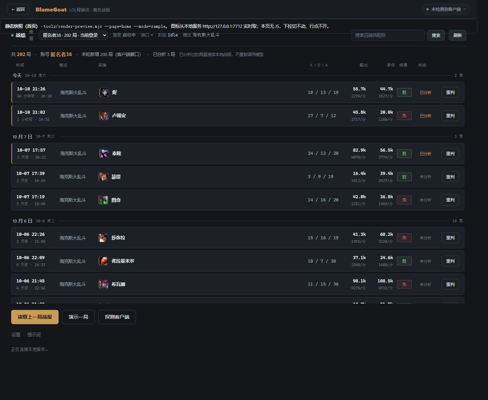
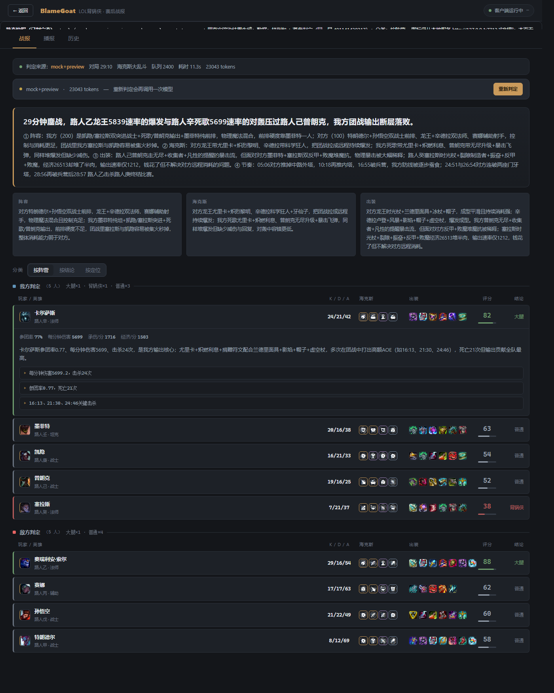

# LOL背锅侠 · BlameGoat

> 一局大乱斗打完，官方只给你一串数字。**BlameGoat 把它读成人话** —— 谁是大腿、谁该背锅，每条结论都附数值证据。


本地跑的小工具：对局结束后，从**你自己的客户端**只读取出这一局的客观数据，
整理成一份**去关联化**的数据集交给大模型，产出十个人的角色判定与一份局势复盘，
落盘成可分享的战报。

---

## 这解决什么问题

打完一局，你其实想知道三件事：**这局输在哪、谁的问题、我打得怎么样**。
但结算界面只有 KDA、伤害、承伤一堆数字 —— 数字不会告诉你「对面这套阵容我们根本开不了团」，
也不会告诉你「这个人装备出了但一件都不解决问题」。

BlameGoat 做的就是这段翻译。它不是数据面板，是一个**结论 + 证据**的复盘助手。

| 输出 | 内容 |
|---|---|
| 角色标签 | **大腿 / 背锅侠 / 不粘锅 / 混子 / 普通**（附 0-10 评分） |
| 个人理由 | 150 字成链的判定说明 + 至少 3 条硬证据（引用具体数值或时间点） |
| 局势复盘 | 300-400 字，四层结构：阵容 → 海克斯 → 出装 → 节奏 |
| 团队洞察 | 阵容 / 海克斯 / 出装各一条独立结论 |
| 时间轴 | 一局 190+ 条事件按时间铺开，攻守双方按阵营着色 |
| 播报稿 | 可直接念的语音文案（TTS 播报待接入） |

---

## 界面

**首页 = 当前账号的战绩列表**，打开就能看，点任意一行展开这一局。



**战报页 = 逐行评分表**：左半是客观数据（K/D/A · 海克斯 · 出装），右半是判定结果（评分 · 结论），
十个人一行一个，「他带了什么」和「我们怎么判」摆在同一条线上才对照得起来。

**敌我一色到底**：只要出现召唤师名字就带阵营色 —— **我方绿 / 敌方红**。评分表、时间轴、历史榜、
播报稿，以及模型写的长文里点到的名字，全走同一套；对局详情顶部另有一枚「我方胜 / 我方负」徽标
（胜负是客观数据，未判定也照样显示）。认不出我方阵营时一律不上色 —— 宁可全灰，也不把十个人都染成红方骗人。



> 配图来自脱敏样例（身份已替换为「路人甲…路人癸」），渲染脚本见 `tools/render-preview.mjs`。

---

## 三条设计原则

### 1. 「看」与「判」是两件事

点开一局**不花一分钱** —— 拉的是 `/api/match-detail`，只有客观数据。
要不要判定，得显式点页顶的「开始分析」，那是**全站唯一**会调用模型的入口。

判定一旦开始，**过程是看得见的**：进度页那一行实时显示「模型思考中 / 输出中（已输出 N 字）/ 校验 / 完成」，
带秒表。十几秒的等待不再是干转动画 —— 模型一直在写，就看得见它一直在写。

```
点行看详情 ──→ 客观数据（KDA / 出装 / 时间轴）     ¥0
点开始分析 ──→ 调用模型 → 标签 + 评分 + 复盘       约 ¥0.004
```

同一局判定过一次就落盘，之后再打开直接读盘，**不重复烧 token**。
后台监视器默认也只登记、不判定（`data/config.json` 的 `autoAnalyze`，默认 `false`）。

> 为什么要拆：大部分时候你点开只是想看看这局谁玩得离谱、带了什么装备，这不需要模型。
> 把「看数据」和「下结论」绑在一个动作上，等于每次「看一眼」都收一次费。

### 2. 隐私是默认值，不是选项

- **真实昵称不出本机**：发给模型前全部替换成 `p1` - `p10`，调用前还会校验有无残留。
- **战报文件里只有 pid**：`data/reports/*.json` 永远不含真名 —— 战报是可以拿出去给人看的。
- **昵称另存本机**：`data/names.json` 负责界面还原，所以自己看得见名字 ——
  代价是**这份文件本身装着真名**，不能跟着战报一起外发（见下一条）。
- **纯本地只读**：不做内存读取、不注入、不改包、不模拟键鼠；服务只监听 `127.0.0.1`。
- **本地 API 只认本机界面**：校验 `Host` 必须是回环地址（挡 DNS rebinding），
  `/api/*` 一律要每次启动随机生成的会话令牌（令牌随首屏 HTML 下发），
  写请求还强制 `Content-Type: application/json`（堵「简单请求免预检」的 CSRF 通道）。
- **能拿出去分享的只有 `data/reports/*.json`** —— 战报里是 `p1`-`p10`，不含真名，可以发给别人看。
  `data/` 这个目录**整体不可以外发**：它里面还有 `names.json`（每局 10 个真实昵称）、
  `roster.json`（名录，真实昵称 + puuid）、`searched/*.json`（查过的别人的战绩）、
  `search-history.json`（最近搜过谁）、`account-probe.json`（参与者数据）——
  这些都是**他人个人信息**。
  「匿名」只对战报文件和发给模型的数据成立，不是对整个 `data/` 成立。
- **用户配置目录里那份是明文 Key**，不要外发（Windows：`%LOCALAPPDATA%\LOL背锅侠\config.json`）。

### 3. 查别人的数据，不进我的库

按昵称搜到某人、翻 TA 的历史，结果只写 `data/searched/{puuid}.json`，
**绝不写进「我的战绩」索引、也不新增账号**。靠文件物理隔离，不靠标记位 ——
`ui-smoke.mjs` 里有一条断言守着：查完一个人，「我的战绩」总条数必须**逐字节不变**。

---

## 功能一览

| 能力 | 说明 |
|---|---|
| 客户端对接 | 跨盘符探测 lockfile、日志兜底取端口、HTTPS 自签调用、阶段轮询 |
| 数据整理 | 三源合并（EOG + 对局详情 + 时间轴），去关联化输出 |
| 判定链路 | 提示词 v3.2（9 区块 + 15 参数 + 3 档语气）、结构化校验、本地兜底降级 |
| 战绩列表 | 客户端缓存 ∪ 本地累积索引，按天分组，行内直接带输出 / 承伤与每分钟速率 |
| 多账号隔离 | 每局记归属账号，列表 / 历史 / 计数按账号过滤；一台机器换号登录数据不混 |
| 召唤师查询 | 查本机客户端缓存里见过的人，按 TA 的视角分我方 / 敌方 |
| 自动监视 | 结束态轮询 + 每 30s 查新对局双路兜底；默认只登记不判定 |
| 离线可用 | 无客户端、无 Key、断网时降级到本地兜底判定，功能不中断 |
| 自检工具链 | 多个零依赖 CLI 脚本，见下文 |

---

## 快速开始

**前置**：Windows + 英雄联盟客户端（国服）+ Node.js 18 以上。**不需要 npm install**。

```bash
# 1. 双击启动（起本地服务并自动开浏览器）
start.bat

# 2. 环境自检（客户端 / 源码 / 战报 / 提示词 / 模型连通性）
check.bat
```

配 DeepSeek Key 有三种方式，任选其一：

1. 界面 →「设置」页填入（**推荐**，界面会告诉你明文落在哪儿）；
2. 设环境变量 `DEEPSEEK_API_KEY`（优先级最高）；
3. 写进用户配置文件 —— Windows：`%LOCALAPPDATA%\LOL背锅侠\config.json`，
   macOS：`~/Library/Application Support/LOL背锅侠/`，Linux：`$XDG_CONFIG_HOME/LOL背锅侠/`。

> ⚠️ **Key 不写进 `data/`**：`data/` 装着战报（`data/reports/` 那份是可以分享的），
> 目录会被整个搬来搬去，所以它里面不许有凭据。
> 老版本写在 `data/config.json` 里的 Key，启动时会**自动搬**到用户配置目录
> （只搬 Key，语气 / 端口那些偏好原样留在 `data/config.json`）。

**没有 Key 也能用** —— 自动降级到本地兜底判定，只是结论不如模型细。

其他入口：

```bash
node tools/lcu-selftest.mjs        # 客户端：装没装 / 跑没跑 / 能不能应答 / 当前阶段
node prototype/deepseek-judge.mjs  # 命令行跑通「整理 → 判定 → 落盘」全链路
```

只想看看长什么样？首页有个「演示一局」按钮，用真机抓取的**脱敏样例**跑一遍，
一条模型调用都不会发。

---

## 桌面客户端

**只有一种形态：桌面客户端**（页面装在自己窗口里）。
曾经还有一条单文件 exe（Node SEA，起服务后喊系统浏览器当界面），v1.1.1 起下线 ——
页面在浏览器里终究不像个客户端，留着只是让发版时多一个要解释的选择。

| 产物 | 体积 | 说明 |
|---|---|---|
| `dist/LOL背锅侠/` | ~325MB | 便携目录，整个拷走即可运行 |
| `dist/LOL背锅侠-win-x64.zip` | 139MB | 上面那个目录的压缩包，用来分发 |
| `dist/LOL背锅侠-升级包-vX.Y.Z.zip` | ~0.3MB | **日常只发这一个**，拖到 `update.bat` 上 |

```bash
npm run pack:desktop    # 完整打包（便携目录 + 分发 zip + 升级包）
npm run pack:update     # 只打升级包（几十次改动里只会排到这一个命令）
npm run app             # 开发态直接跑桌面客户端，改完源码即生效
```

界面右下角常显当前版本号；升级完成后那一行的版本号会跟着变，
旁边还会补一句「刚刚升级到 vX.Y.Z（时间）」——升级有没有装上，不用翻日志看。

### 装到电脑上（免安装）

打包产物都在 `dist/` 下，**没有安装程序**——所有形态都是「拷过去就能跑」：

| 产物 | 怎么用 | 说明 |
|---|---|---|
| `dist/LOL背锅侠-win-x64.zip`（139MB） | 解压到任意目录 → 双击 `LOL背锅侠.exe` | **推荐**，页面在自己窗口里 |
| `dist/LOL背锅侠/`（325MB，未压缩） | 整个文件夹拷到任意目录 → 双击 exe | 等于上一条解压后的结果，U 盘拷机时更快 |

几条要紧的：

- **目标机器什么都不用装** —— Node 和 Chromium 都打在包里，不写注册表、不申请管理员权限。
- **别把目录放在需要管理员权限的地方**（`C:\Program Files\` 之类），
  因为数据目录 `data/` 就建在 exe 旁边，写不进去会退到 `%LOCALAPPDATA%`。
- **数据跟着 exe 走** —— 战报、账号、设置全在 `data/`，整个目录搬走 = 完整迁移
  （**搬给自己**，不是发给别人：目录里的 `names.json` / `roster.json` / `searched/` 带他人真名与 puuid）；
  卸载就是删掉这个目录（想留战绩的话先备份 `data/`）。
- **第一次双击可能被 Windows 拦一下** —— 没做代码签名，SmartScreen 会提示
  「Windows 已保护你的电脑」，点「更多信息」→「仍要运行」即可（只拦第一次）。
- 目录里还有两个可选工具：`update.bat`（升级入口，见下）与 `install.bat`
  （想装到固定位置、顺手建桌面快捷方式时才用，双击后一路回车即可，默认装到
  `%LOCALAPPDATA%\Programs\LOL背锅侠`）。

### 升级

日常改动只动 `resources/app` 里那几百 KB 代码，240MB 的 Electron 运行时几年才需要更新一次。
所以单独做了一个 **升级包**（`dist/LOL背锅侠-升级包-vX.Y.Z.zip`，约 0.3MB）：

```bash
update.bat <升级包.zip>      # 或把 zip 直接拖到 update.bat 上
```

- **只换代码** —— 覆盖 `resources/app`，exe 与 `data/` 一个字节都不动。
- **先备份再替换** —— 旧代码挪到 `resources/app.bak-<时间戳>`，写坏自动回滚，最多留 2 份。
- **不需要目标机器装 Node** —— update.bat 让 Electron 把自己当 Node 跑起来执行升级器。
- **升级包里绝不许有 `data/`** —— 打包脚本打完会自查一遍，升级器收到含 `data` 的包直接拒绝安装。
  账号、战报、名录的安全性由这两道防线共同保证。
- 老到连 `update.bat` 都没有的安装：解压升级包，双击里面的 `update.bat`，按提示给出客户端所在目录即可
  （一次性；升完就自带升级能力了）。

桌面客户端就是一层 Electron 外壳，主进程只干三件事：把 `server/server.mjs` 当库拉起来
（端口给 `0`，让系统自己挑一个空闲的，永远不会和命令行那份服务抢 7710）、开窗把页面装进去、
收尾。所以：

- **不再弹浏览器** —— 页面就在客户端自己的窗口里，窗口图标是那口金色的锅。
- **双击第二下不会起第二个进程** —— 把已经在跑的窗口叫到面前来（`requestSingleInstanceLock`）。
- **首次运行要等十几秒** —— 客户端得先把历史战绩拉一遍（列表才是空的），之后走本地索引，秒开。
- **目标机器什么都不用装** —— Chromium 与 Node 都在包里，整个目录拷走即可运行。
- **产物里不含任何本机数据** —— 打包时会把冒烟跑出来的 `data/` 清干净，首次运行才自己建。
- **数据仍在 `data/`** —— 就在 exe 旁边；目录不可写时退到 `%LOCALAPPDATA%`。
- **排障看 `data/desktop.log`** —— 客户端没有控制台，日志落这里，超过 1.5MB 自动轮转。
- 快捷键：`F12` 开发者工具 · `F5` 刷新 · `F11` 全屏。

> 体积从 84MB 涨到 320MB，是「页面内嵌」的真实代价：Chromium 得自己带（其中 235MB 就是 Electron 那个
> exe 本身）。换来的是目标机器不需要 Edge WebView2、也不需要 Node —— 插 U 盘就能用。

---

## 工作原理

```
英雄联盟客户端 (LCU)
      │  只读 HTTPS + lockfile/日志取端口
      ▼
  原始数据：EOG + 对局详情 + 时间轴 + 英雄/装备/符文表
      │
      ▼
  normalize.mjs —— 去关联化（四不原则），分配匿名 pid
      │  真实昵称 → p1…p10
      ▼
  prompt.mjs —— 9 区块提示词 + 客观数据集
      │
      ▼
  DeepSeek  ──失败/无 Key──→  本地兜底判定（按大乱斗尺度标定）
      │
      ▼
  结构化校验（JSON / 枚举 / 分数 / 人数 / 标签自洽）
      │
      ▼
  data/reports/{gameId}.json（不含真名）→ 界面渲染 + 战报分享
```

**数据层「四不原则」**：不排名 / 不算均值 / 不做因果关联 / 不预设关联窗口。
边界一句话：字段描述单个玩家或单个事件自身 → 留；描述它们之间的关系 → 删。

> 判断的权力留给模型，参照系不给。规则可以给（「死亡 ≤ 1 判不粘锅」写进提示词），
> 关联不能给（「阵亡后 28 秒丢塔算代价」禁止 —— 那 28 秒得它自己算出来）。

---

## 技术要点

| 项 | 说明 |
|---|---|
| 运行时依赖 | **零**。HTTP 服务、SSE、HTTPS 自签调用全部用 Node 内置模块 |
| 界面 | 单页 + classic script，无框架无构建；`file://` 双击可离线直开 |
| 模型 | DeepSeek（OpenAI 兼容），温度 0.7 / JSON 模式 / 约 ¥0.004 一局 |
| 模式 | 海克斯大乱斗，`mapId = 12` / `queueId = 2400`（真机实测，不硬编码） |
| 打包 | `npm run pack:desktop` → 桌面客户端（Electron 便携目录 + zip + 升级包）；`npm run pack:update` → 只出升级包 |

### 几个真机踩出来的坑

文档和真机不一致的地方，都在开发记录里留了结论，最典型的几条：

- **EOG 玩家对象没有 `participantId`** —— 直接按它分 pid，十个人会塌成同一个。
  必须用对局详情的 `participantIdentities` 桥接。
- **EOG 顶层没有 `queueId` / `mapId`**，`championName` 是**称号**不是英雄名
  （`41` → 「海洋之灾」，玩家说的是「普朗克」），`events` **恒为空数组**。
- **国服 WeGame 版 lockfile 可能是 0 字节**，哪怕客户端正在运行 ——
  只能回退到读客户端日志的启动命令行取端口。
- **`gameId` 与开局时间不同序** —— 编号更大不代表打得更晚，排序必须用 `gameCreation`。

排查过程与全部实测结论见 [`docs/DEVNOTES.md`](docs/DEVNOTES.md)。

---

## 项目结构

```
start.bat / check.bat          一键启动 / 环境自检
desktop/                       Electron 主进程：内嵌服务 + 窗口（`npm run app` 直跑）
server/                        HTTP 服务 + REST API + SSE、业务编排、账号与名录
src/lcu/                       客户端对接：连接、详情装配、英雄表、装备符文表、去关联化
src/deepseek/                  提示词模板（单一事实来源）+ 判定链路（校验 / 兜底）
web/                           界面（零依赖，api.js 连不上后端时自动降级离线）
tools/                         自检与运维 CLI（见下）
prototype/sample/              真机抓取的脱敏样例数据包
docs/                          开发记录与截图
```

---

## 自检工具链

改完代码跑一遍，都是零依赖脚本：

```bash
node tools/check-identifiers.mjs   # 揪「调用了但没导入 / 没定义」的标识符
node tools/check-perspective.mjs   # 扫战报：敌我分组有没有塌（我方 0 人或 10 人）
node tools/check-prompt-sync.mjs   # 提示词副本是不是忘了跟着源文件重新生成
node tools/ui-smoke.mjs            # DOM 桩真跑 web/：账号隔离 / 日期分割 / 点行看详情 / 数据隔离
node tools/check-judge-progress.mjs # 判定过程：阶段有没有真的推出来（兜底也给原因）
node tools/check-api-guard.mjs     # 本地 API：令牌 / CORS / Host / Content-Type / 安全响应头
node tools/check-index-guard.mjs   # 战绩索引：并发写不丢条目、对局归属只认「本人在不在局里」
node tools/check-update-pack.mjs   # 升级链路：update.bat 能被 cmd 解析、升级包清单齐全、沙盘里真装一遍
node tools/render-preview.mjs      # 把界面渲染结果落成自包含 HTML 快照
```

> `check-identifiers.mjs` 值得单独说：Node 只在**真正执行到那一行**才抛 `ReferenceError`，
> 漏导入的函数平时静默，等真跑到那条链路才整条炸掉。这个脚本在自检阶段就把它拦下来。

工具链零外部依赖，npm 源不通也照样能跑。

---

## 已知边界与计划

**这是能力边界，不是没做完**：

- **查某人的战绩：能拿到他自己的对局，不只你俩同场的那几局** ——
  `match-history/products/lol/{puuid}/matches` 对**任意已知 puuid** 是按人返回的
  （四个人的 accountId、gameId 集合各不相同）。查询清单 = 名录 ∪ 客户端战绩，
  实测对「名录里只见过 1 局的人」能拿 51 局，其中 50 局你根本不在场。
  上限：只有近 50 局左右、`begIndex` 翻页无效、条数随客户端缓存浮动（实测 11～51）。
- **但 puuid 的来源仍然只有名录** —— 按名字查人不可行：
  `summoners?name=` 只吃 `gameName#tagLine`，中文名直接 422；
  `昵称#tag` 404、`by-puuid` 404、v2 400。
  所以「能查到谁」= 他出现在你读过的某一局里（名录目前 3000 余人）。
- **任何对局都能看、也能判** —— 任何真实的 gameId 都能打开详情（v1.2.4 起不再设归属闸：
  LCU 就在本机、界面就在本机，这道闸挡不住谁、只挡了正当路径）；
  v1.2.7 起判定也开放了，**判定结果按对局 ID 缓存在 `data/reports/<gameId>.json`**，
  与这局归谁无关。唯一的区别：判**别人**的局不会写 `matches.json`，
  那一局不会出现在「我的战绩」列表里（界面会明说这一点）。
- **判别人的局需要指定视角** —— 查某人 → 判定他的某一局时自动带上他的 puuid；
  不带的话你不在场，会被判成「10 人全是敌方」。
- 页顶右缘常驻**对局 ID**，点一下复制 —— 对着 `data/reports/<gameId>.json` 就能核实是哪一局。
- 首次查询一个两百局的陌生人是 5-6 秒（要逐局读详情），已有内存缓存。

**路线图**：

- [x] 客户端对接 + 数据整理 + 判定链路
- [x] 真机全链路验证（29:10 / 191 条事件 / 10 名玩家）
- [x] 多账号归属隔离、召唤师查询、界面重做
- [ ] 历史榜接真实落盘数据（目前是样例聚合）
- [ ] TTS 语音播报（方案已实证，待实施：Edge TTS → 虚拟声卡 → YY 麦克风，见「开发笔记」第十三节）
- [x] Electron 外壳 —— 页面装进客户端自己的窗口，不再借浏览器（见「桌面客户端」）

---

## 免责声明

- 本项目与 Riot Games、腾讯**无任何关联**，未获其授权或认可。
- 只通过官方客户端本地接口**只读**取数据，不做内存读取、注入、改包，
  也不提供自动接受对局、自动点赞、模拟键鼠等任何破坏游戏公平的功能。
- 请遵守游戏用户协议，自行承担使用风险。

## License

**GPL-3.0（仅 v3，不含 “or any later version”）** —— 全文见 [LICENSE](LICENSE)。

选它而不是 MIT，是因为这是一份**注定会被人拿去改造**的工具：基于它做的衍生版本
必须同样以 GPL-3.0 开源，不能闭源发布。**商用仍然允许**，只是源码要一并给出。

> 分发 exe / 安装包时请附上本仓库地址 —— GPL 要求随分发物提供完整源码。
> 仓库里的 `data/` 与 `preview/` 已排除：那是本机真实战绩与昵称，本来也不属于源码。
